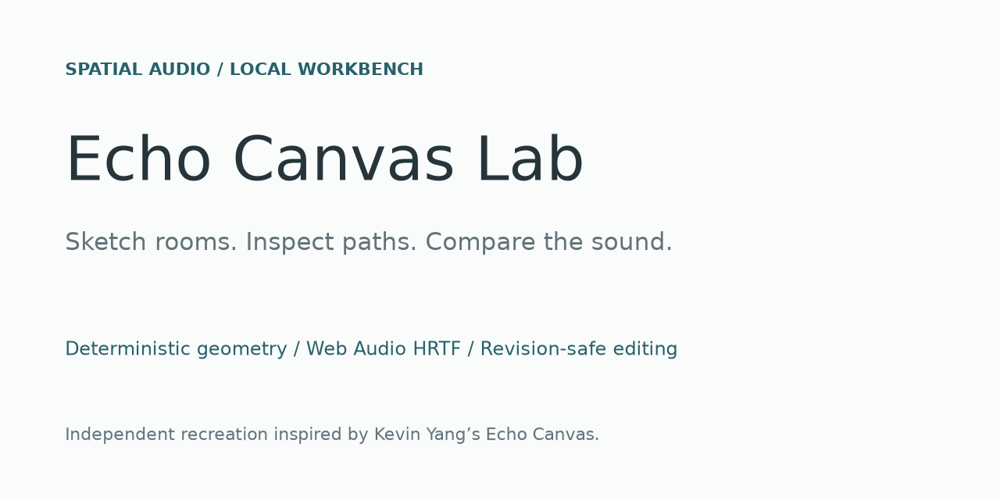

# Echo Canvas Lab

A local workbench for sketching rooms and hearing an approximate spatial-audio model. Edit sources, listeners, walls, and doorways, then inspect the paths that drive browser HRTF playback.



An **independent recreation inspired by [Echo Canvas](https://devpost.com/software/echo-canvas-ujzksi), by Kevin Yang**. A verified original public repository was not found in the November 27, 2026 search. This project uses original code and does not claim the original hackathon award or full feature parity.

[Portfolio case study](docs/PORTFOLIO.md) · [Model and limitations](docs/MODEL.md) · [Changes and recommendations](docs/IMPROVEMENTS.md)

## Run

Python 3.11+; a modern browser with Web Audio. No package installation, account, key, AI call, or external hardware is required to use the app.

```sh
git clone https://github.com/victorhuii/echo-canvas-lab.git
cd echo-canvas-lab
python3 server.py
```

Open **http://127.0.0.1:8772**, then click **Play**. The app starts quietly at 25% output. Use `--port 8774` for a different port; stop with Ctrl+C. Headphones can make spatial differences easier to hear but are optional.

## Use it

1. Load **Doorway study**. Select the partition and close its doorway. Inspect the obstructed direct path and modeled transmission loss.
2. Open the doorway. The primary route bends through its center, and the apparent source follows the last doorway.
3. Drag a source or listener, or select an object and type precise values. A selected wall exposes draggable endpoint handles.
4. Switch between **Simulated** and **Raw / dry mono**. Raw mode bypasses path filtering, delay, spatial panning, and the wet tail.
5. Switch to the separate **3D project** for height controls and elevation diagnostics, including eligible floor and ceiling reflections.
6. Export versioned scene JSON or import it later. Undo/redo and separate per-mode browser saves preserve authoring work.

## Included

- Independent 2.5D/3D scenes; room dimensions/material, up to 8 sources, 4 selectable listeners, and 12 finite walls with optional doorways.
- Deterministic direct obstruction, illustrative material transmission loss, doorway visibility routing, and up to six strongest first-order reflection paths per source.
- Dedicated module worker with a coalesced latest-scene queue. Revision checks prevent stale results from controlling displayed paths or audible parameters.
- Persistent Web Audio graph with HRTF panners, distance attenuation, delay, low-pass filtering, and a damped four-comb reverberant tail.
- Sine/noise sources and optional local mono/stereo audio files up to 20 MB and two minutes. Missing files remain explicitly silent.
- Numeric controls, viewport dragging, source/listener/wall creation and removal, active listener selection, undo/redo, local saves, strict JSON validation, and import/export.

Local audio stays in the tab and is not embedded in scene JSON. Attach files again after reload/import. The cache holds at most 16 decoded asset IDs; replacing the same source's attachment reuses its ID. Importing does not execute code or load remote media.

## Model boundaries

This is an acoustic sketch, not a calibrated room simulator. Material coefficients are illustrative broadband values; reverb is a bounded perceptual approximation. Doorway routing uses visible opening centers, not a diffraction solver. The RT60 estimate is not a measurement of the rendered tail. See [MODEL.md](docs/MODEL.md).

Natural-language AI authoring, arbitrary meshes, measured HRTF datasets, wave diffraction, head tracking, and game-engine export are not included. Deterministic presets keep this version usable without paid APIs.

## Tests

Node 24 is used for development checks:

```sh
npm ci
npm test
python3 -m unittest discover -s tests -p 'test_*.py' -v
node --check web/app.js
```

18 JavaScript tests and one Python HTTP test pass. Checks cover geometry, scene validation, undo/revisions, the actual worker module, audio graph lifecycle, and real editor markup/handlers through a development-only DOM harness. The app itself has no npm runtime dependency.

Browser visual QA and perceptual listening were unavailable in the build environment. Graph tests verify Web Audio API usage with test doubles; they do not establish audible quality or browser compatibility. The generated portfolio diagrams show computed geometry, not app screenshots.

## Files

```text
web/scene.js       schema, presets, revision gate, history
web/acoustics.js   deterministic paths and reverb estimate
web/worker.js      geometry worker
web/audio.js       persistent browser audio graph
web/app.js         editor and accepted-revision coordination
server.py          fixed-asset loopback server
```

The server accepts no scene/audio uploads. Browser storage is local to its origin; changing the port creates another storage origin. Scene exports can contain user-entered names and layouts, so inspect them before sharing. MIT license; original project attribution is preserved in the documentation.
