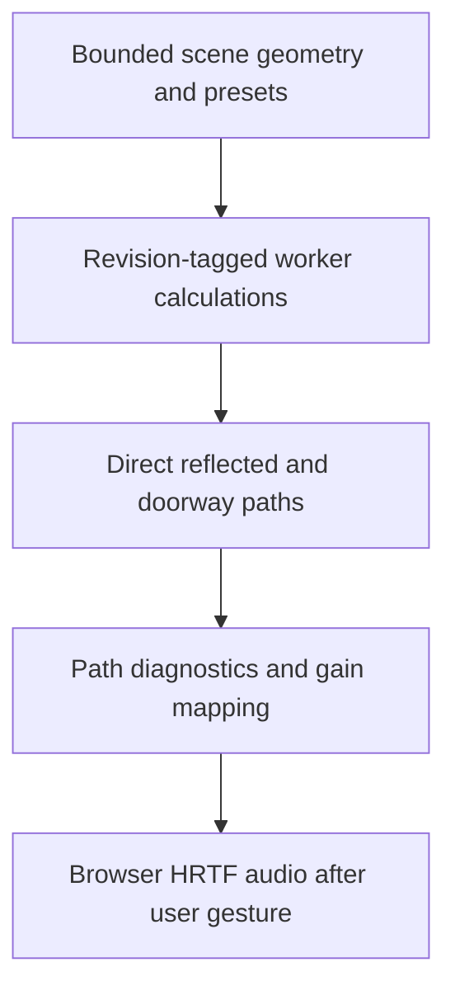

# Architecture

A local spatial-audio workbench with deterministic geometry, doorway routing, and revision-safe WebAudio controls.

## Data flow

## Source map

- [web/scene.js](../web/scene.js)
- [web/acoustics.js](../web/acoustics.js)
- [web/worker.js](../web/worker.js)
- [web/audio.js](../web/audio.js)
- [web/app.js](../web/app.js)

## Evidence and boundaries

Original code inspired by Kevin Yang; geometry and audio lifecycle checks. Inspired by Kevin Yang; no verified upstream source or original award ownership claimed.

See [setup and recorded results](../README.md), [design choices](DECISIONS.md), and [portfolio notes](PORTFOLIO.md).
