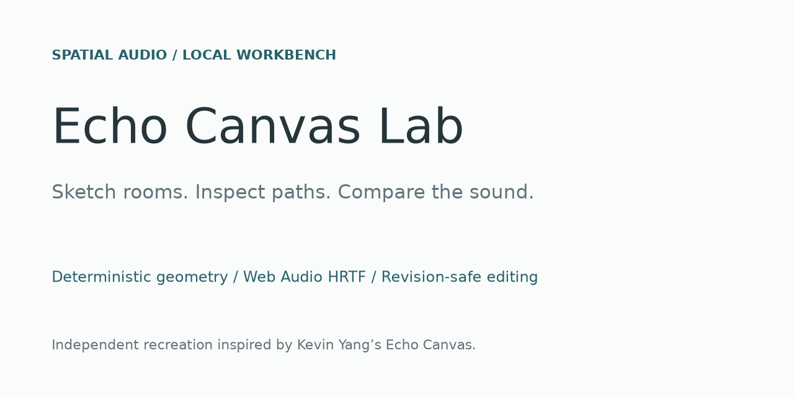
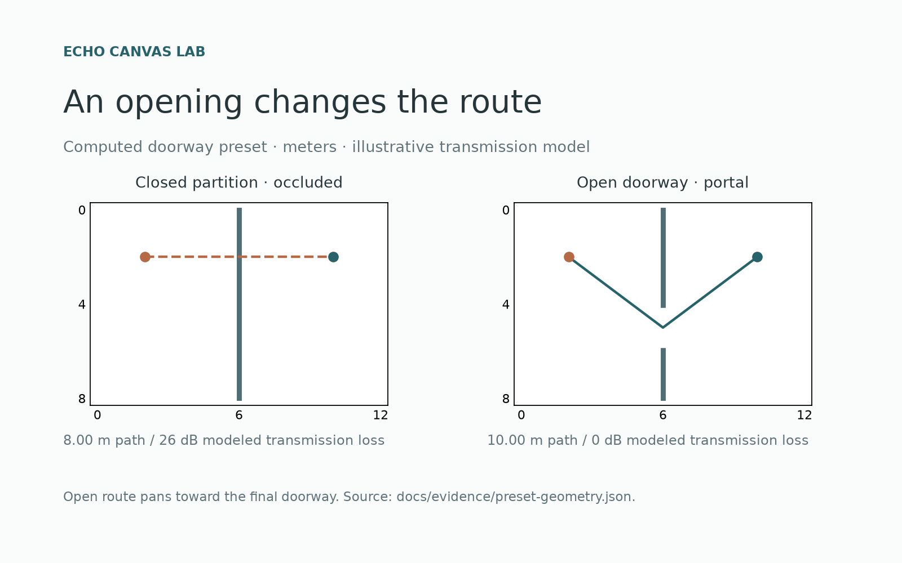
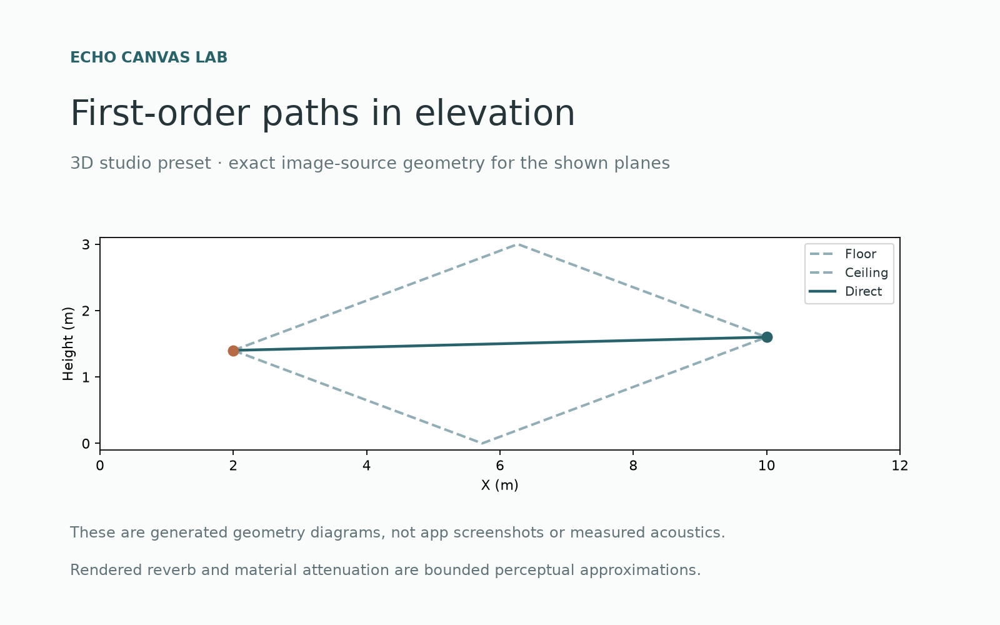

# Echo Canvas Lab

An independent browser workbench for exploring room geometry and approximate spatial audio.

[Repository](https://github.com/victorhuii/echo-canvas-lab) · [Model details](MODEL.md) · [Original inspiration: Echo Canvas by Kevin Yang](https://devpost.com/software/echo-canvas-ujzksi)

## Project card

**Description:** Sketch rooms, move sound sources and listeners, and hear a local spatial-audio approximation. The workbench combines deterministic geometry workers, doorway routing, first-order reflections, and browser HRTF playback with revision-safe editing and strict scene imports.

**Stack:** JavaScript · Web Audio · Web Workers · SVG · Python

**Cover:** [1280 × 640 PNG](assets/cover.png) · [SVG](assets/cover.svg)

## Problem and approach

Spatial sound is difficult to discuss from an abstract floor plan. This project connects a small editable scene to visible acoustic paths and a local audio graph. The model is deliberately bounded: show what changed, preserve the scene, and keep old calculations from controlling current audio.

The code is independently implemented from the public project description. It does not claim the original hackathon award, authorship, codebase, AI scene compiler, or full simulation fidelity.

## Doorway study

The default scene places a source and listener on opposite sides of a concrete partition. A closed doorway applies modeled transmission loss. Opening the off-axis doorway produces a visible route through its center and changes the apparent source direction.

[PNG](assets/doorway-routing.png) · [SVG](assets/doorway-routing.svg). Geometry comes from [preset-geometry.json](evidence/preset-geometry.json), generated by the checked-in engine. This is a diagram, not a screenshot or measured acoustic response.

## Three-dimensional paths

The 3D project adds height editing and elevation diagnostics. Eligible floor and ceiling reflections use mirrored-source geometry; blocked or invalid legs are rejected. The audio graph renders at most six strongest first-order paths for each enabled source.

[PNG](assets/reflection-paths.png) · [SVG](assets/reflection-paths.svg). Material loss and reverb remain illustrative perceptual models.

## Engineering decisions

- Geometry runs in a worker and carries a scene revision. Coalescing prevents an unbounded queue while dragging; stale responses are rejected.
- The persistent Web Audio graph reuses nodes during edits. Removed sources release generators and disconnect their paths.
- Raw/Simulated comparison mutes the reverb tail in Raw mode. It does not claim loudness normalization.
- Versioned JSON imports validate fields, IDs, geometry, counts, and numeric bounds. Audio blobs and remote URLs are excluded.
- Separate cached projects and undo/redo keep editing reversible without a backend or account.

## Demo

Run `python3 server.py`, open http://127.0.0.1:8772, and click Play. Close and reopen the partition doorway, move the source, compare Raw and Simulated, then switch to 3D. Export the scene and reimport it to show the format boundary. Local audio attachments must be restored separately.

## Validation and limits

18 JavaScript checks pass across geometry, validation, revisions/history, actual worker execution, graph lifecycle, and actual editor markup/handlers in a DOM harness. A Python HTTP check verifies asset routes and host/path restrictions. Browser visual QA and perceptual listening were unavailable; no audible-quality, calibration, performance, or browser-compatibility result is claimed.

## Resume copy

Built an independent spatial-audio workbench with deterministic geometry workers, portal routing, first-order reflections, and a persistent HRTF audio graph. Added revision-safe editing, per-mode history, strict scene imports, and 19 automated checks.

## Asset provenance

The three PNG/SVG pairs are generated graphics and computed-path diagrams, not app screenshots. Recreate the evidence JSON with the engine and run `python3 scripts/portfolio_assets.py` in an environment with Matplotlib. The app itself needs no Python packages or npm runtime install.

MIT license. Original inspiration: Kevin Yang's Echo Canvas. Independent code and portfolio materials: Victor Hui.
